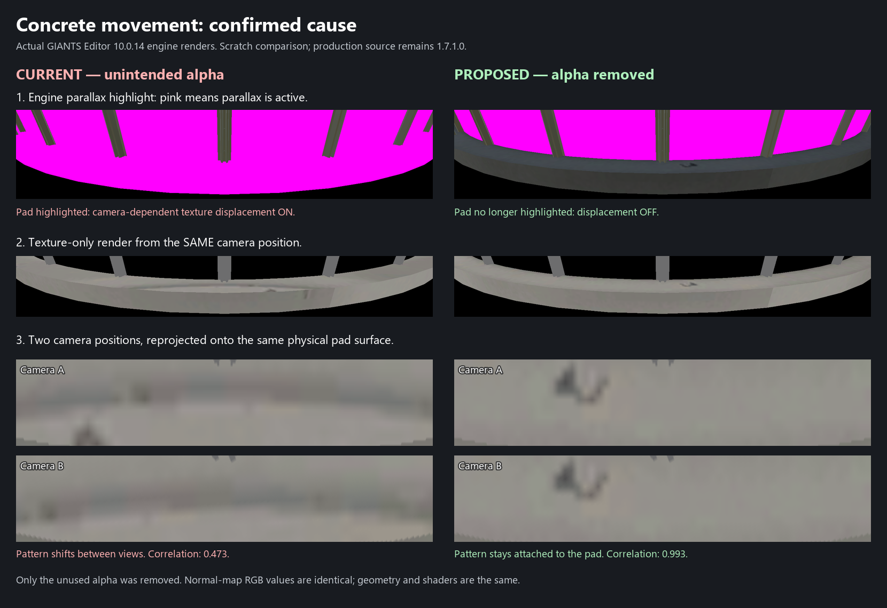

# Concrete foundation movement: 1.7.2.0

The concrete foundation appeared to slide as the player walked or turned around a PRX silo. Version 1.7.1.0
improved the normal-map relief and side UV scale, but left the cause of the remaining movement in place.

The normal map was stored as BC3/DXT5 with an unused, solid-white alpha channel. GIANTS interprets a fourth
normal-map channel as a height map and automatically enables parallax mapping. White represents maximum height,
so the texture was displaced according to the viewing angle on a physically flat foundation. This happens even
without selecting the building shader's `customParallax` variation.

The texture conversion helper had unconditionally converted RGB PNGs to RGBA before writing DXT5. The fix removes
only the concrete normal map's opaque alpha and stores its original colour blocks as BC1/DXT1. Decoded RGB pixels
are identical in all 12 mip levels. All three silos reference this one concrete normal map. Other runtime assets,
including geometry and concrete diffuse/specular maps, are unchanged.

## Verification

GIANTS Editor 10.0.14 loaded scratch copies with the same geometry, shader and camera:

| Check | Before | Corrected |
|---|---|---|
| Engine normal format | `U4CHANNEL` (3) | `U3CHANNEL` (2) |
| Parallax debug highlight on pad | Pink: enabled | No highlight: disabled |
| Normal-map RGB difference, all 12 mips | Reference | Zero |
| Correlation between two views reprojected onto the physical pad | 0.472750 | 0.992928 |
| Mean absolute pixel difference across 70,942 samples | 9.3208 | 0.3183 |

The corrected texture stays attached to the physical pad in the matched engine renders. The integrated 1.7.2.0
build remains **untested in the running game**. Reflection, screen-space-shadow and TAA comparisons were also
performed during diagnosis; the user's original graphics settings were restored afterward.

The comparison was made before integration, so its caption identifies the corrected asset as a proposal.
That exact asset is now the approved 1.7.2.0 concrete normal map.

## Preventing a repeat

- `python tools/verify_concrete_normal.py` rejects an alpha-bearing concrete normal map or an incomplete mip chain.
- `python tools/png_to_dds.py input_normal.png output_normal.dds` stores RGB normal maps without an alpha channel.
  Intentional RGBA normal/height maps retain that channel; other texture types retain the former DXT5 behavior.
- `python tools/strip_normal_alpha.py input_normal.dds output_normal.dds` removes an opaque alpha from an existing
  BC3 normal map and verifies decoded RGB equality across every mip. It rejects non-opaque height data.
- `--normal-rgb` explicitly removes unused opaque alpha when converting a normal PNG that already has an alpha channel.

GIANTS describes the same moving-texture symptom and automatic alpha-driven parallax in
[Stefan Geiger's explanation on GDN](https://gdn.giants-software.com/thread.php?categoryId=7&threadId=861).

The tools, notes and comparison image are development files and are excluded from the mod ZIP.
