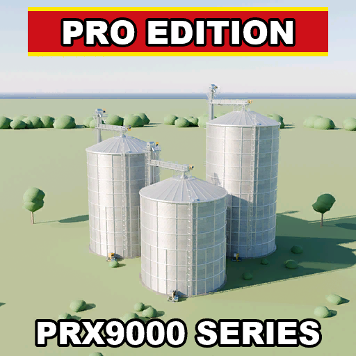

# ModHub upload: Pro X (PRX) Silo Extensions Pro Edition

What to enter in the GIANTS ModHub upload form for this mod. Each text box below has a copy button on GitHub.



**Mod Icon (512x512):** [`icon_512.png`](icon_512.png)

| Field | Value |
|-------|-------|
| Title English | Pro X (PRX) Silo Extensions Pro Edition |
| Title German | Pro X (PRX) Silo-Erweiterungen Pro Edition |
| Title French | Extensions de silo Pro X (PRX) Pro Edition |
| Version | `1` `7` `3` `1` |
| Author | DTM Mods, PropaineX |
| Manufacturer | Lizard |
| Category 1 | Placeable > Silo Extensions |
| Category 2 | Not Set |
| Category 3 | Not Set |

## Title English
```text
Pro X (PRX) Silo Extensions Pro Edition
```

## Title German
```text
Pro X (PRX) Silo-Erweiterungen Pro Edition
```

## Title French
```text
Extensions de silo Pro X (PRX) Pro Edition
```

## Description English
```text
Pro X 9000 (PRX9000)
Category: Silo Extensions
Price: $450,000
Monthly upkeep: $100

Pro X 8000 (PRX8000)
Category: Silo Extensions
Price: $360,000
Monthly upkeep: $80

Pro X 6000 (PRX6000)
Category: Silo Extensions
Price: $270,000
Monthly upkeep: $60

Pro X (PRX): huge corrugated steel silo extensions with a caged ladder. All 18 m wide.

PRX9000: 10,000,000 L, 32 m walls
PRX8000: 8,000,000 L, 25.6 m walls
PRX6000: 6,000,000 L, 19.2 m walls

Place one near one of your silos to add its storage.
```

## Description German
```text
Pro X 9000 (PRX9000)
Kategorie: Siloerweiterungen
Preis: 450.000 €
Monatliche Unterhaltskosten: 100 €

Pro X 8000 (PRX8000)
Kategorie: Siloerweiterungen
Preis: 360.000 €
Monatliche Unterhaltskosten: 80 €

Pro X 6000 (PRX6000)
Kategorie: Siloerweiterungen
Preis: 270.000 €
Monatliche Unterhaltskosten: 60 €

Pro X (PRX): riesige Silo-Erweiterungen aus Wellblech mit Rückenschutzleiter. Alle 18 m breit.

PRX9000: 10.000.000 L, 32 m Wandhöhe
PRX8000: 8.000.000 L, 25,6 m Wandhöhe
PRX6000: 6.000.000 L, 19,2 m Wandhöhe

In der Nähe eines deiner Silos platzieren, um dessen Lager zu erweitern.
```

## Description French
```text
Pro X 9000 (PRX9000)
Catégorie : Extensions de silo
Prix : 450 000 $
Entretien mensuel : 100 $

Pro X 8000 (PRX8000)
Catégorie : Extensions de silo
Prix : 360 000 $
Entretien mensuel : 80 $

Pro X 6000 (PRX6000)
Catégorie : Extensions de silo
Prix : 270 000 $
Entretien mensuel : 60 $

Pro X (PRX) : d'énormes extensions de silo en tôle ondulée avec échelle à crinoline. Toutes font 18 m de large.

PRX9000 : 10 000 000 L, murs de 32 m
PRX8000 : 8 000 000 L, murs de 25,6 m
PRX6000 : 6 000 000 L, murs de 19,2 m

Placez-en une près d'un de vos silos pour agrandir son stockage.
```

## Screenshots

Upload the 4 images in [`screenshots/`](screenshots/) (1600x900, unedited in-game shots) in this order: [`1.jpg`](screenshots/1.jpg), [`2.jpg`](screenshots/2.jpg), [`3.jpg`](screenshots/3.jpg), [`4.jpg`](screenshots/4.jpg).

## Before uploading

- The store items have `<brand>NONE</brand>` (no brand); Manufacturer is set to Lizard, GIANTS' own no-name brand.
- The mod adds 31 fill types of its own (crops from other maps and mods, such as lentils, tobacco, hemp and buckwheat) so the silos match the Fed Mods silos used on the group's server. ModHub testers may question fill types that only matter with other content; decide whether to keep them in the ModHub version.
- The mod itself has English and German texts only (modDesc title and description; the shop names "Pro X 9000 (PRX9000)" etc. are not translated), and the modDesc description does not mention the fill types yet. The French texts here do not add French to the mod.
