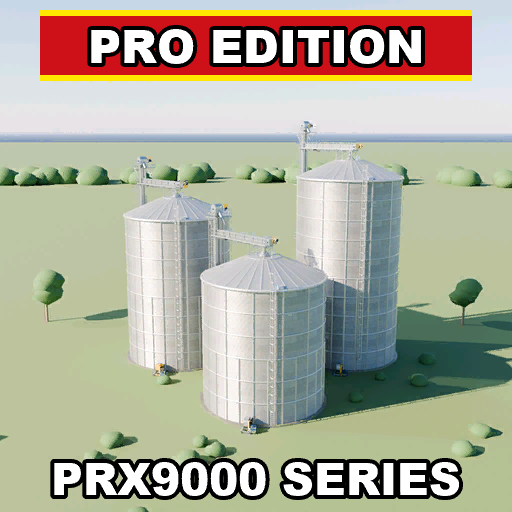

# ModHub upload: Pro X (PRX) Silo Extensions Pro Edition

What to enter in the GIANTS ModHub upload form for this mod. Each text box below has a copy button on GitHub.



**Mod Icon (512x512):** [`icon_512.png`](icon_512.png)

| Field | Value |
|-------|-------|
| Title English | Pro X (PRX) Silo Extensions Pro Edition |
| Title German | Pro X (PRX) Silo-Erweiterungen Pro Edition |
| Title French | Extensions de silo Pro X (PRX) Pro Edition |
| Version | `1` `7` `3` `1` |
| Author | DTM Mods, PropaineX |
| Manufacturer | Lizard |
| Category 1 | Placeable > Silo Extensions |
| Category 2 | Not Set |
| Category 3 | Not Set |

## Title English
```text
Pro X (PRX) Silo Extensions Pro Edition
```

## Title German
```text
Pro X (PRX) Silo-Erweiterungen Pro Edition
```

## Title French
```text
Extensions de silo Pro X (PRX) Pro Edition
```

## Description English
```text
Pro X (PRX): three huge corrugated steel silo extensions with a caged ladder, built from scratch. Place one near one of your silos and its capacity is added to that silo's storage. All three are 18 m wide.

- PRX9000: 10,000,000 L, 32 m walls, price 450,000
- PRX8000: 8,000,000 L, 25.6 m walls, price 360,000
- PRX6000: 6,000,000 L, 19.2 m walls, price 270,000
- Stores 75 crops and products. The extensions bring their own fill types, so they also hold crops that are not in the base game. Fill types that already exist in the game or another mod are left untouched.
- Galvanised steel walls with ring seams, a flat-topped roof, aeration blower, bucket elevator, conveyor and roof fill, on a concrete foundation pad.
- Shop: Buildings > Silo Extensions. Multiplayer supported.

Changelog 1.7.3.0:
- The silos now also store onions (clean and dirty), bananas and coffee cherries.
- Bananas and coffee cherries need a map or DLC that has them; without them they are simply skipped.
```

## Description German
```text
Pro X (PRX): drei riesige Siloerweiterungen aus Wellblech mit Rückenschutzleiter, komplett selbst gebaut. In der Nähe eines deiner Silos platzieren, und ihre Kapazität wird dem Lager dieses Silos hinzugefügt. Alle drei sind 18 m breit.

- PRX9000: 10.000.000 L, 32 m Wandhöhe, Preis 450.000
- PRX8000: 8.000.000 L, 25,6 m Wandhöhe, Preis 360.000
- PRX6000: 6.000.000 L, 19,2 m Wandhöhe, Preis 270.000
- Lagert 75 Feldfrüchte und Produkte. Die Erweiterungen bringen eigene Fülltypen mit und nehmen so auch Feldfrüchte auf, die es im Grundspiel nicht gibt. Fülltypen, die das Spiel oder eine andere Mod schon hat, bleiben unverändert.
- Verzinkte Stahlwände mit Ringnähten, flaches Dach, Belüftungsgebläse, Becherwerk, Förderband und Dachbefüllung, auf einem Betonfundament.
- Shop: Gebäude > Siloerweiterungen. Mehrspielerfähig.

Changelog 1.7.3.0:
- Die Silos lagern jetzt auch Zwiebeln (sauber und verschmutzt), Bananen und Kaffeekirschen.
- Bananen und Kaffeekirschen brauchen eine Karte oder ein DLC, die sie enthalten; ohne sie werden sie einfach übersprungen.
```

## Description French
```text
Pro X (PRX) : trois énormes extensions de silo en tôle ondulée avec échelle à crinoline, entièrement faites maison. Placez-en une près d'un de vos silos et sa capacité s'ajoute au stockage de ce silo. Toutes les trois font 18 m de large.

- PRX9000 : 10 000 000 L, murs de 32 m, prix 450 000
- PRX8000 : 8 000 000 L, murs de 25,6 m, prix 360 000
- PRX6000 : 6 000 000 L, murs de 19,2 m, prix 270 000
- Stocke 75 cultures et produits. Les extensions apportent leurs propres types de remplissage et acceptent donc aussi des cultures absentes du jeu de base. Les types de remplissage qui existent déjà dans le jeu ou dans un autre mod restent inchangés.
- Murs en acier galvanisé avec joints annulaires, toit plat, ventilateur d'aération, élévateur à godets, convoyeur et remplissage par le toit, sur une dalle de fondation en béton.
- Boutique : Bâtiments > Extensions de silo. Compatible multijoueur.

Changelog 1.7.3.0 :
- Les silos stockent maintenant aussi les oignons (propres et sales), les bananes et les cerises de café.
- Les bananes et les cerises de café nécessitent une carte ou un DLC qui les contient ; sinon, elles sont simplement ignorées.
```

## Before uploading

- The store items have `<brand>NONE</brand>` (no brand); Manufacturer is set to Lizard, GIANTS' own no-name brand.
- The patch notes mark 1.7.3.0 as "Untested in the running game". Test it in game before uploading.
- The mod adds 31 fill types of its own (crops from other maps and mods, such as lentils, tobacco, hemp and buckwheat) so the silos match the Fed Mods silos used on the group's server. ModHub testers may question fill types that only matter with other content; decide whether to keep them in the ModHub version.
- The mod itself has English and German texts only (modDesc title and description; the shop names "Pro X 9000 (PRX9000)" etc. are not translated), and the modDesc description does not mention the fill types yet. The French texts here do not add French to the mod.
